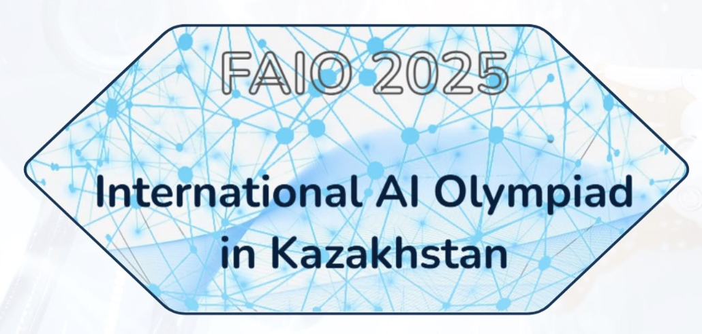

<!-- DOCTOC SKIP -->

<h1 align="center">
  
   FAIO 2025
</h1>

  🎓 2nd edition — tasks, solutions & starter kits.

  
  
  

---

### 🧠 Qualification Round
- 📘 **Readme:** [Open](./qualification/README.md)

**Tasks:**
[1 — Statistics 101](./qualification/task1_stats_101.md) ·
[2 — Probability Theory 101](./qualification/task2_Probability_theory_101.md) ·
[3 — Medicine](./qualification/task3_Medicine.md) ·
[4 — Who Speaks What?](./qualification/task4_Who_Speaks_What.md) ·
[5 — AI Yoga Instructor](./qualification/task5_Can_You_Become_AI_Yoga_Instructor.md) ·
[6 — Simple Objects](./qualification/task6_Simple_Objects.md)

---

### 🏁 1st Round
- 📘 **Readme:** [Open](./day1/README.md)
- 📄 **Translations (KZ/RU):** [PDF](./day1/1st-round-FAIO-2025-KZ-RU.pdf)

**Problems:**
[1 — Qaz-letters](./day1/qaz_letters.md) ·
[2 — Who is the best pitcher?](./day1/Who_is_the_best_pitcher.md) ·
[3 — Missing Fundamental Puzzle](./day1/Missing_Fundamental_Puzzle.md)

---

### 🚀 2nd Round
- 📘 **Readme:** [Open](./day2/README.md)
- 📄 **Translations (KZ/RU):** [PDF](./day2/2nd-round-FAIO-2025-KZ-RU.pdf)

**Problems:**
[1 — HearMe: Personalized Music Recommender](./day2/HearMe_Personalized_Music_Recommender.md) ·
[2 — Lost in the Museum](./day2/Lost_in_the_Museum.md)

---

## Other years
- [FAIO 2026](https://github.com/faio-official/faio-2026)
- [FAIO 2024](https://github.com/faio-official/faio-2024)
- [All FAIO repositories](https://github.com/faio-official)

---

## 👥 Credits
### Organizers | Jury | Authors

  
  
  
  
  
  
  
  
  

---

  Part of <a href="https://github.com/faio-official">FAIO Tasks</a> · Licensed under <a href="./LICENSE">Apache-2.0</a>

