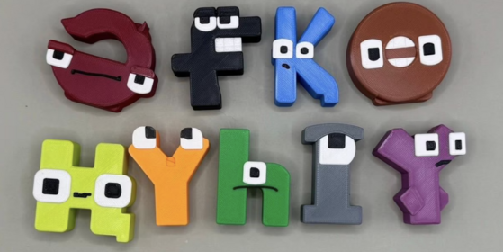

<div align="center">
    
</div>

## Overview

The Kazakh language uses a Cyrillic-based script with 42 distinct characters, including nine unique letters. While modern computer vision often relies on large, end-to-end deep learning models, this challenge places the spotlight on expert feature engineering and classical machine learning (ML) techniques.

Participants will not work with raw image files but with a curated, pre-processed tabular dataset where the visual information of each Kazakh letter image has been distilled into a set of handcrafted, numerical features.

## Description

Your task is to build a classification model using a tabular dataset. This dataset contains a comprehensive set of features:

- Statistical Features:
  - Mean intensity: Average pixel value.
  - Standard deviation: Pixel value spread.
  - Min/Max intensity: Helps capture extremes.
  - Skewness/Kurtosis: Measures asymmetry and peakedness of intensity distribution.
  - Histogram of pixel values: Divide intensity into bins (e.g., 16 bins) and count occurrences.
- Shape-Based / Geometric Features:
  - Centroid: Center of mass of the digit.
  - Bounding box: Width, height, and aspect ratio.
  - Pixel density: Fraction of non-zero pixels.
  - Edge pixels count: Number of boundary pixels using edge detection.
  - Moments / Hu moments: 7 invariant moments describing shape, rotation, scale invariant.
  - Contours: Number of contours or contour areas using OpenCV.
  - Radial features: Distance of non-zero pixels from centroid.
  - Fourier descriptors of contours: Shape descriptors invariant to rotation/scale.
  - Symmetry measures: Compare left-right or top-bottom halves.
- Projection / Profile Features:
  - Horizontal & vertical projections: Sum of pixel values along rows and columns.
  - Zoning features: Divide image into zones (e.g., 4x4) and calculate density in each zone.
- Transform-Based Features:
  - Fourier Transform: Frequency domain coefficients.
  - Discrete Cosine Transform (DCT): Common in compression, captures low-frequency patterns.
  - Wavelet Transform: Multi-scale decomposition, capturing edges and textures.

## Files

- **train.csv** — the training set (13 104 rows). Columns: `ID`, the engineered features `f0, f1, …, f1918`, and `label` — the true character class as an integer in `[0, 41]`.
- **test.csv** — the test set (3 276 rows). Columns: `ID` and the same features `f0 … f1918`; `label` is withheld.
- **sample_submission.csv** — a submission in the correct format, with columns `ID,label` (one row per test example).
- **labels.json** — the mapping from each Kazakh letter to its integer class, e.g. `{"х": 0, "в": 1, …, "а": 41}` (42 entries).

## Submission format

Predict the integer class `label` ∈ `[0, 41]` for every test example. Your submission must follow
`sample_submission.csv` exactly: the same `ID` values in the same order, with your predicted `label`.

```
ID,label
0,41
1,12
2,7
...
```

## Evaluation

Submissions are scored by **accuracy** — the share of test letters classified correctly (from 0 to 1).

## Data

[Download data.zip (173.8 MB)](https://contest.faio.kz/problems/01a1b5a6-0f99-75c4-9aa2-a50a88258ff3/public/data.zip)

```bash
wget https://contest.faio.kz/problems/01a1b5a6-0f99-75c4-9aa2-a50a88258ff3/public/data.zip
```

The archive contains `train.csv`, `test.csv`, `sample_submission.csv` and `labels.json`.
