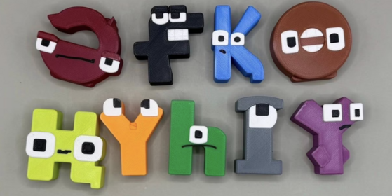

<div align="center">
    
</div>

## Шолу

Қазақ тілі 42 таңбадан тұратын кирилл əліпбиін қолданады, оның ішінде тоғыз ерекше əріп бар. Қазіргі компьютерлік көру əдістері көбінесе көлемді, соңы біртұтас терең нейрондық желілерге сүйенсе, бұл жарыста басты назар — ерекшелік құрастыру (feature engineering) мен классикалық машиналық оқыту (ML) əдістерін қолдануға аударылады.

Қатысушылар өңделмеген кескіндермен жұмыс істемейді. Олардың орнына əр қазақ əрпінің бейнесі бойынша визуалды ақпарат мұқият дайындалған, сандық сипаттамаларға түрлендірілген кестелік деректер жиыны беріледі.

## Сипаттама

Сіздің міндетіңіз — кестелік деректер жиынын пайдалана отырып, классификация моделін құру. Бұл деректер жиынында келесі толық сипаттамалар бар:

- Статистикалық белгілер:
  - Орташа қарқындылық: пиксельдердің орташа мəні.
  - Стандартты ауытқу: пиксель мəндерінің таралуы.
  - Минималды/максималды қарқындылық: экстремалды мəндерді анықтауға көмектеседі.
  - Асимметрия/эксцесс (skewness/kurtosis): қарқындылықтың асимметриясын жəне өткірлігін өлшейді.
  - Пиксель мəндерінің гистограммасы: қарқындылықты интервалдарға (мысалы, 16 бөлікке) бөліп, олардың жиілігін есептейді.
- Пішінге / геометрияға негізделген белгілер:
  - Центроид: таңбаның масса орталығы.
  - Шектеуші тікбұрыш (bounding box): ені, биіктігі жəне жақтар қатынасы.
  - Пиксель тығыздығы: нөлге тең емес пиксельдердің үлесі.
  - Шекара пиксельдерінің саны: шекараларды анықтау əдісімен алынған пиксельдер саны.
  - Моменттер / Ху моменттері: пішіннің айналу мен масштабқа тəуелсіз 7 инвариантты сипаттамасы.
  - Контурлар: контурлардың саны немесе олардың аудандары (OpenCV арқылы алынған).
  - Радиалды белгілер: нөлге тең емес пиксельдердің центроидқа дейінгі қашықтықтары.
  - Фурье-дескрипторлар: айналу мен масштабқа тəуелсіз пішін сипаттамалары.
  - Симметрия өлшемдері: сол/оң немесе үстіңгі/астыңғы бөліктердің ұқсастығын салыстыру.
- Проекциялық / профильдік белгілер:
  - Көлденең жəне тік проекциялар: пиксель мəндерінің жолдар мен бағандар бойынша қосындысы.
  - Аймақтық белгілер (zoning): кескінді аймақтарға бөлу (мысалы, 4×4) жəне əр аймақтағы пиксель тығыздығын есептеу.
- Түрлендіру негізіндегі белгілер:
  - Фурье түрлендіруі: жиілік аймағындағы коэффициенттер.
  - Дискретті косинустық түрлендіру (DCT): көбіне сығу əдістерінде қолданылады, төмен жиілікті үлгілерді анықтайды.
  - Вейвлет түрлендіруі: көпмасштабты ыдырату, шеттер мен текстураларды сипаттайды.

## Файлдар

- **train.csv** — оқыту жиыны (13 104 жол). Бағандар: `ID`, жасалған белгілер `f0, f1, …, f1918` жəне `label` — таңбаның нақты класы (бүтін сан, `[0, 41]` аралығында).
- **test.csv** — тест жиыны (3 276 жол). Бағандар: `ID` жəне сол `f0 … f1918` белгілері; `label` жасырылған.
- **sample_submission.csv** — дұрыс пішімдегі үлгі жіберу файлы, бағандары `ID,label` (əр тест мысалына бір жол).
- **labels.json** — əрбір қазақ əрпін оның бүтін класына сəйкестендіретін кесте, мысалы `{"х": 0, "в": 1, …, "а": 41}` (42 жазба).

## Жіберу пішімі

Əрбір тест мысалы үшін бүтін `label` класын (`[0, 41]` аралығында) болжаңыз. Жіберу файлыңыз `sample_submission.csv`-пен дəл сəйкес болуы керек: сол `ID` мəндері, сол ретпен, сіз болжаған `label` мəнімен.

```
ID,label
0,41
1,12
2,7
...
```

## Бағалау

Шешімдер **Accuracy** метрикасы бойынша бағаланады — дұрыс жіктелген тест əріптерінің үлесі (0-ден 1-ге дейін).

## Деректер

[data.zip жүктеу (173.8 MB)](https://contest.faio.kz/problems/01a1b5a6-0f99-75c4-9aa2-a50a88258ff3/public/data.zip)

```bash
wget https://contest.faio.kz/problems/01a1b5a6-0f99-75c4-9aa2-a50a88258ff3/public/data.zip
```

Мұрағат құрамында `train.csv`, `test.csv`, `sample_submission.csv` жəне `labels.json` файлдары бар.
