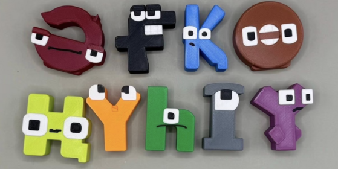

<div align="center">
    
</div>

## Обзор

Казахский язык использует кириллический алфавит, состоящий из 42 символов, включая девять уникальных букв. Хотя современные методы компьютерного зрения часто опираются на модели глубокого обучения, в данном соревновании внимание уделяется искусству построения признаков и применению классических методов машинного обучения (ML).

Участники не будут работать с необработанными изображениями, а получат специально подготовленный табличный набор данных, где визуальная информация о каждой букве казахского алфавита преобразована в набор тщательно разработанных числовых признаков.

## Описание

Ваша задача — построить классификационную модель, используя табличный набор данных. Этот набор данных содержит полный набор признаков:

- Статистические признаки:
  - Средняя интенсивность: среднее значение пикселя.
  - Стандартное отклонение: разброс значений пикселей.
  - Минимальная/максимальная интенсивность: помогает захватывать экстремумы.
  - Асимметрия/эксцесс (skewness/kurtosis): измеряют асимметрию и остроту распределения интенсивностей.
  - Гистограмма значений пикселей: разделение интенсивности на интервалы (например, 16 бинов) и подсчёт вхождений.
- Признаки, основанные на форме / геометрии:
  - Центроид: центр масс символа.
  - Ограничивающий прямоугольник: ширина, высота и соотношение сторон.
  - Плотность пикселей: доля ненулевых пикселей.
  - Количество граничных пикселей: число пикселей границы, получаемое методом детекции границ.
  - Моменты / моменты Ху: 7 инвариантных моментов, описывающих форму, инвариантных к повороту и масштабу.
  - Контуры: число контуров или площади контуров, извлечённые с помощью OpenCV.
  - Радиальные признаки: расстояния ненулевых пикселей от центроида.
  - Фурье-дескрипторы контуров: дескрипторы формы, инвариантные к вращению/масштабу.
  - Меры симметрии: сравнение левой-правой или верхней-нижней половин.
- Проекционные / профильные признаки:
  - Горизонтальные и вертикальные проекции: сумма значений пикселей по строкам и столбцам.
  - Зонирование (zoning): деление изображения на зоны (например, 4×4) и вычисление плотности в каждой зоне.
- Преобразовательные признаки:
  - Преобразование Фурье: коэффициенты в частотной области.
  - Дискретное косинусное преобразование (DCT): широко используется в сжатии, захватывает низкочастотные паттерны.
  - Вейвлет-преобразование: многомасштабное разложение, захватывающее края и текстуры.

## Файлы

- **train.csv** — обучающая выборка (13 104 строк). Столбцы: `ID`, построенные признаки `f0, f1, …, f1918` и `label` — истинный класс символа (целое число в диапазоне `[0, 41]`).
- **test.csv** — тестовая выборка (3 276 строк). Столбцы: `ID` и те же признаки `f0 … f1918`; `label` скрыт.
- **sample_submission.csv** — пример отправки в правильном формате, со столбцами `ID,label` (одна строка на каждый тестовый пример).
- **labels.json** — отображение каждой казахской буквы в её целочисленный класс, например `{"х": 0, "в": 1, …, "а": 41}` (42 записи).

## Формат отправки

Для каждого тестового примера предскажите целочисленный класс `label` ∈ `[0, 41]`. Ваша отправка должна в точности соответствовать `sample_submission.csv`: те же значения `ID` в том же порядке и ваш предсказанный `label`.

```
ID,label
0,41
1,12
2,7
...
```

## Оценка

Решения оцениваются по метрике **Accuracy** — доля правильно классифицированных тестовых букв (от 0 до 1).

## Данные

[Скачать data.zip (173.8 MB)](https://contest.faio.kz/problems/01a1b5a6-0f99-75c4-9aa2-a50a88258ff3/public/data.zip)

```bash
wget https://contest.faio.kz/problems/01a1b5a6-0f99-75c4-9aa2-a50a88258ff3/public/data.zip
```

Архив содержит `train.csv`, `test.csv`, `sample_submission.csv` и `labels.json`.
