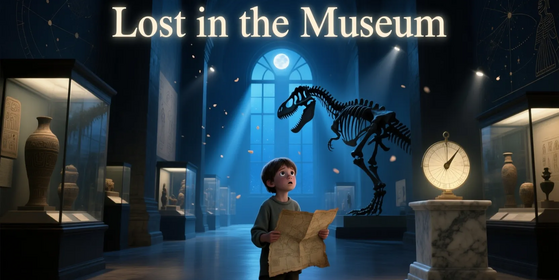

<div align="center">
    
</div>

## Шолу

«Мұражайда» атты жарысқа қош келдіңіз — мұнда компьютерлік көру өнермен бетпе-бет келеді, ал сіздің модельіңіз əлемдегі ең білгір мұражай кураторына айналады.

Сізге мұражайға келушілер түсірген, атышулы туындылардың 1 000 нақты фотосуреті беріледі. Бұл суреттер көлеңкелі, қатты жақындатылған, нашар жарықтандырылған болуы мүмкін. Сіздің міндетіңіз — осы «сапасы төмен» фотосуреттердің əрқайсысы үшін мұражай архивтерінен алынған 10 000 жоғары сапалы сурет коллекциясы арасынан дəл сəйкестікті табу.

Жазулар жоқ. Метадеректер жоқ. Тек пиксельдер — басқа ештеңе жоқ.

Бұл — домендер арасындағы қатты сəйкессіздік жағдайындағы ең күрделі сурет іздеу есептерінің бірі: сіздің модельіңіз күнделікті түсірілімнің «хаосын» көре білуі жəне оны мінсіз цифрлық баламасымен байланыстыруы тиіс.

## Сипаттама

Сізге 20 000 суреттен тұратын деректер жиыны берілген. Олардың ішінде:

- 10 000 — мұражай коллекцияларынан алынған студиялық сападағы (HQ) суреттер.
- 1 000 — «сұраныс» суреттері: келушілер əртүрлі жетілмеген жағдайларда түсірген нақты фотосуреттер (қозғалыс бұлыңғырлығы, жарқырау, кесу, төмен ажыратымдылық, əртүрлі орындарда, əртүрлі нысандарда).
- 9 000 — «толтырғыш» суреттер — алаңдатқыштар. Оларға басқа өнер туындылары немесе кескіндемеге мүлдем қатысы жоқ суреттер кіруі мүмкін.

Сіздің міндетіңіз — жіктеу, анықтау немесе қолмен сəйкестендіру емес, əрбір 20 000 сурет үшін белгіленген ұзындықтағы бірыңғай белгі векторын (эмбеддингті) жасау. Бұл эмбеддингтер HQ жəне сұраныс суреттерінің арасындағы домендік айырмашылыққа төзімді түрде визуалды мазмұнды кодтауы керек.

Қай суреттер — сұраныс, қайсысы — HQ, қайсысы — толтырғыш екені сізге айтылмайды. Сіз барлық суреттерді бірдей өңдеп, белгілерді тек олардың пиксель мазмұнынан шығаруыңыз керек.

Мақсат — сыртқы түрінің күрт айырмашылығына қарамастан, сұраныс суреті мен оған сəйкес HQ туынды жақын орналасатын, ал қате сəйкестіктерден алыс болатын белгілер кеңістігін үйрену.

Ескертпе: бұл сіз қолмен орындайтын іздеу есебі емес. Сіз тек эмбеддингтерді жібересіз. Барлық салыстыру мен бағалау тек ұйымдастырушыларға белгілі жабық шынайы сəйкестікті (ground truth) пайдалана отырып, сервер жағында жүргізіледі.

## Бағалау

Шешімдер **Hit@3** метрикасы бойынша, сервер жағында келесі түрде бағаланады.

### 1-қадам: Косинустық жақындық бойынша сəйкестендіру

Əрбір 1 000 жабық «сұраныс» суреті үшін оның эмбеддинг векторы мен галереядағы барлық 10 000 жоғары сапалы (HQ) жəне 9 000 толтырғыш суреттің эмбеддинг векторлары арасындағы косинустық жақындық есептеледі.

Сұраныс эмбеддингі **q** мен галерея эмбеддингі **g** арасындағы косинустық жақындық былай анықталады:

$$
\text{similarity}(\mathbf{q}, \mathbf{g}) = \frac{\mathbf{q} \cdot \mathbf{g}}{\|\mathbf{q}\|_2 \cdot \|\mathbf{g}\|_2}
$$

мұнда:
**q·g** — екі вектордың скаляр көбейтіндісі
|**q**|_2 жəне |**g**|_2 — векторлардың L2 нормалары.

Ең жақсы нəтиже үшін эмбеддингтерді L2-нормалау ұсынылады, дегенмен нормаланбаған жіберулер де қабылданып, бағаланады.

### 2-қадам: Үш ең жақсы кандидатты таңдау

Əрбір сұраныс үшін барлық 19 000 эмбеддинг косинустық жақындық бойынша кему ретімен сұрыпталады. Жақындығы ең жоғары 3 галерея суретінің ID-і сəйкестік кандидаттары ретінде таңдалады.

### 3-қадам: Hit@3 метрикасын есептеу

Егер сұраныстың шынайы сəйкес HQ туындысы (жабық ground truth бойынша) табылған Top-3 тізімінде болса, «попадание» (hit) есепке алынады.

Соңғы нəтиже былай есептеледі:

$$
\text{Hit@3} = \frac{\text{Top-3 ішінде дұрыс сəйкестігі бар сұраныстар саны}}{1000}
$$

Бұл баға 0.0-ден 1.0-ге дейінгі мəнді қабылдайды. Баға неғұрлым жоғары болса, іздеу соғұрлым жақсы. Қатысушылар көпшілік лидерлер тақтасында Hit@3 мəнінің кемуі бойынша орналасады.

**Ескертпе**: Жарыс аяқталғаннан кейін нəтиженің қайталанатынын тексеру жəне алаяқтықтың алдын алу үшін жұмыс дəптерін (notebook) тапсыру қажет.

## Жіберу файлы

Сіз `submission.csv` атты бір CSV файлын жасап, жүктеуіңіз керек.

Файлда дəл 20 000 жол болуы керек — деректер жиынындағы əрбір сурет үшін бір жол — қайталаулар мен қалдырулар болмауы тиіс.

Əрбір жол келесі мəліметтерді қамтиды:

- image_name (мысалы, 00001.png)
- Белгіленген саны бар белгі өлшемдері (мысалы, feature_0, feature_1, ..., feature_D-1), мұнда D — сіз таңдаған эмбеддинг ұзындығы (сапа мен тиімділіктің тепе-теңдігі үшін 256 немесе 512 ұсынылады)

```python
ID,image_name,feature_0,feature_1,feature_2,feature_3,...,feature_D-1
00001.png,00001.png,0.1234,-0.5678,0.9101,...,0.4421
00002.png,00002.png,-0.3312,0.8876,-0.0045,...,1.2039
...
```
Барлық 20 000 сурет ID мен image_name көрсетілуі керек — ешқандай сүзгілеу, сұрыптау немесе қалдыру болмауы тиіс.
Үлгі жіберу файлын деректер жиыны бөлімінен табуға болады.

## Деректер жиынының сипаттамасы
### Файлдар
Барлық суреттер (сұраныстарды қоса) dataset қалтасында орналасқан.

**submission.csv** — дұрыс пішімдегі үлгі жіберу файлы

## Деректер

[lost-in-the-museum-v2.zip жүктеу (10.81 GB)](https://contest.faio.kz/problems/01a1b5a8-12d6-7083-a9cd-62c03320840d/public/lost-in-the-museum-v2.zip)

```bash
wget https://contest.faio.kz/problems/01a1b5a8-12d6-7083-a9cd-62c03320840d/public/lost-in-the-museum-v2.zip
```
