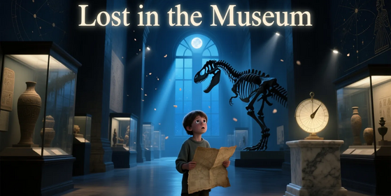

<div align="center">
    
</div>

## Обзор

Добро пожаловать в «Заблудившегося в музее» — соревнование, где компьютерное зрение сталкивается с искусством, а ваша модель превращается в самого проницательного куратора на свете.

Перед вами — 1 000 реальных фотографий знаменитых полотен, сделанных посетителями музеев: с тенями, сильным приближением, бликами, размытием и плохим освещением. Ваша задача — для каждой из этих «неказистых» фотографий найти точное соответствие среди безупречной коллекции из 10 000 высококачественных изображений картин из музейных архивов.

Никаких подписей. Никаких метаданных. Только пиксели — и ничего больше.

Это одна из самых сложных задач поиска изображений в условиях сильного несоответствия доменов: вашей модели предстоит научиться «видеть сквозь хаос» повседневной съёмки и находить связь с идеальным цифровым аналогом.

## Описание

Вам дан датасет из 20 000 изображений. Среди них:

- 10 000 — эталонные, студийного качества (HQ) изображения картин из музейных коллекций.
- 1 000 — «запросы»: реальные фото, сделанные посетителями в самых разных несовершенных условиях (размытие от движения, блики, обрезка, низкое разрешение, в разных местах, на разных объектах).
- 9 000 — «приманки»: посторонние изображения-дистракторы. Они могут включать другие произведения искусства или вообще не относиться к живописи.

Ваша задача — не классифицировать, детектировать или вручную подбирать пары, а сгенерировать для каждого из 20 000 изображений единый вектор фиксированной длины (эмбеддинг). Эти эмбеддинги должны кодировать визуальное содержание устойчиво к доменному разрыву между HQ и запросными изображениями.

Вы не будете знать, какие изображения — запросы, какие — HQ, а какие — приманки. Все изображения следует обрабатывать одинаково, выводя признаки исключительно из их пиксельного содержания.

Цель — построить такое пространство признаков, в котором, несмотря на огромную разницу во внешнем виде, запросное изображение и соответствующая ему HQ-картина оказываются близко — и далеко от неверных соответствий.

Примечание: это не задача поиска, которую вы выполняете вручную. Вы отправляете только эмбеддинги. Всё сопоставление и оценка производятся на стороне сервера с использованием закрытой разметки (ground truth), известной только организаторам.

## Оценка

Решения оцениваются по метрике **Hit@3**, которая рассчитывается на стороне сервера следующим образом.

### Шаг 1: Сопоставление по косинусной близости

Для каждого из 1 000 закрытых «запросных» изображений вычисляется косинусная близость между его эмбеддингом и эмбеддингами всех 10 000 высококачественных (HQ) и 9 000 «приманочных» изображений галереи.

Косинусная близость между эмбеддингом запроса **q** и эмбеддингом изображения из галереи **g** определяется как:

$$
\text{similarity}(\mathbf{q}, \mathbf{g}) = \frac{\mathbf{q} \cdot \mathbf{g}}{\|\mathbf{q}\|_2 \cdot \|\mathbf{g}\|_2}
$$

где:
**q·g** — скалярное произведение двух векторов
|**q**|_2 и |**g**|_2 — L2 нормы векторов.

Для наилучших результатов рекомендуется отправлять L2-нормализованные эмбеддинги, хотя ненормализованные отправки также принимаются и оцениваются.

### Шаг 2: Выбор трёх лучших кандидатов

Для каждого запроса все 19 000 эмбеддингов сортируются по убыванию косинусной близости. Три изображения галереи с наибольшими значениями близости выбираются в качестве кандидатов на соответствие.

### Шаг 3: Расчёт метрики Hit@3

«Попадание» (hit) засчитывается, если истинная соответствующая HQ-картина запроса (согласно закрытой разметке) оказывается среди трёх лучших кандидатов (Top-3).

Итоговый результат вычисляется по формуле:

$$
\text{Hit@3} = \frac{\text{Число запросов с правильным соответствием в Top-3}}{1000}
$$

Эта оценка принимает значения от 0.0 до 1.0. Чем выше значение — тем лучше поиск. Участники ранжируются в публичном лидерборде по убыванию их Hit@3.

**Примечание**: После завершения соревнования требуется предоставить рабочий ноутбук для проверки воспроизводимости результата и исключения возможного жульничества.

## Файл отправки

Вам необходимо сгенерировать и загрузить один CSV-файл с именем `submission.csv`.

Файл должен содержать ровно 20 000 строк — по одной для каждого изображения из датасета — без дубликатов или пропусков.

Каждая строка должна включать:

- image_name (например, 00001.png)
- Фиксированное число признаков (например, feature_0, feature_1, ..., feature_D-1), где D — выбранная вами размерность эмбеддинга (рекомендуем 256 или 512 для баланса качества и эффективности)

```python
ID,image_name,feature_0,feature_1,feature_2,feature_3,...,feature_D-1
00001.png,00001.png,0.1234,-0.5678,0.9101,...,0.4421
00002.png,00002.png,-0.3312,0.8876,-0.0045,...,1.2039
...
```
Все 20 000 ID изображений и image_name должны быть представлены — без фильтрации, сортировки или пропусков.
Пример файла отправки можно найти в разделе датасета.

## Описание датасета
### Файлы
Все изображения (включая запросы) находятся в папке dataset.

**submission.csv** — пример файла отправки в правильном формате

## Данные

[Скачать lost-in-the-museum-v2.zip (10.81 GB)](https://contest.faio.kz/problems/01a1b5a8-12d6-7083-a9cd-62c03320840d/public/lost-in-the-museum-v2.zip)

```bash
wget https://contest.faio.kz/problems/01a1b5a8-12d6-7083-a9cd-62c03320840d/public/lost-in-the-museum-v2.zip
```
