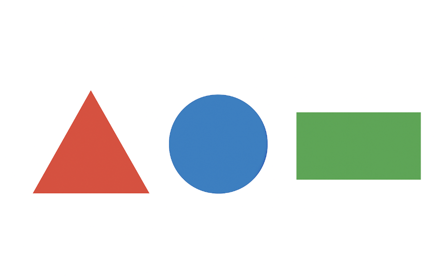

<div align="center">
    
</div>

## Оқиға

Геометрия деген шуақты қалада болашақ сәулетші Әділханға маңызды тапсырма берілді: жаңа «ПолиПарк» рекреациялық кешенінің жобаларын талдау. Бұл кешен негізгі геометриялық пішіндерден тұратын болашақты технологиямен жасалған. Материал шығынын есептеу, құрылыс бригадаларын тағайындау және 3D-басып шығару роботтарының кестесін жасау үшін, қаланың әкімі Дархан әрбір жобада неше түрлі геометриялық фигуралар (үшбұрыштар, тіктөртбұрыштар, шеңберлер т.б.) бар екенін дәл білуі керек.

Өкінішке орай, Әділханның көмекшісі барлық жобаларды векторлық диаграммалар немесе CAD файлдары ретінде емес, RGB кескіндері түрінде сақтап қойған. Сондықтан автоматты есептеу бағдарламасы жұмыс істемей жатыр! Қала әкімі Әділханнан осы есептеулерді жұмыс күні біткенше дайындап беруді сұрап отыр. Сондықтан Әділхан **сіздерге** — өте зерек мектеп оқушыларынан көмек сұрап отыр.

Әрбір жоба кескіні **100-ден 500-ге дейін** геометриялық фигуралардан тұрады. Фигуралар өлшемі, түсі және бағдары бойынша әртүрлі болуы мүмкін. Бірақ олар әрқашан нақты, үзіліссіз шекаралармен салынған және бір-бірімен қиылыспайды немесе екімәнді түрде араласпайды (яғни әр фигураны анық бөліп тануға болады). Сіздің міндетіңіз — берілген RGB сурет бойынша жобадағы геометриялық фигуралардың **нақты санын** шығаратын бағдарлама жазу.

## Есептің шарты

Сізге стандартты RGB форматындағы (мысалы, PNG немесе JPG) суреттер берілген. Олардың өлшемі $2048 \times 2048$ пиксельден тұрады. Әрбір суретте N геометриялық фигура бар ($100 \leq N \leq 500$). Фигуралар үшбұрыш, төртбұрыш немесе шеңберден тұруы мүмкін. Фигуралар үзіліссіз түсті шекаралармен (контурмен) салынған және ішкі аймағы мөлдір немесе боялған болуы мүмкін. Фон фигуралардың шекараларынан анық ажыратылады.

## Кіріс мәліметтер

- Әрбір тест үшін бір RGB кескін файлы беріледі.
- Кескін OpenCV, PIL сияқты кең тараған кескін өңдеу кітапханаларымен оқылатын стандартты форматта (мысалы, PNG немесе JPG) беріледі.
- Фигуралар шекаралары қабаттаспайды. Шекара пиксельдерін қарастырғанда әр фигура — бір байланысқан компонент болып табылады.

## Шығыс мәліметтер

- CSV файл (submit.csv). Әрбір қатарда бір ғана бүтін сан: кескінде анықталған геометриялық фигуралардың жалпы саны.

**Өте маңызды!** submit.csv файлын ғана жіберіңіз. Бастапқы код қажет емес. submit.csv ішіндегі идентификатор мәндерінің реті 0-ден бастап ең жоғары идентификаторға дейін test.csv ішіндегі ретті қатаң сақтауы тиіс.

## Бағалау әдісі:

Сіздің шешіміңіз 8000 кескін бойынша тексеріледі.

Бағалау метрикасы — **Арнайы дәлдік (Customized Accuracy)**, ол төмендегі формулалар арқылы анықталады.

$$\text{Қате деңгейі} = \frac{ \left| \hat{y} - y \right| }{ y }$$

$$\text{Дәлдік} = 1 - \min\left(1, \text{Қате деңгейі}\right)$$

$$\text{Қорытынды баға} = \begin{cases} 0, & \text{егер } \text{Дәлдік} > 0.55 \\ \frac{\text{Дәлдік} - 0.55}{1 - 0.55}, & \text{басқаша жағдайда} \end{cases}$$

$$\textbf{Белгілеулер:} \quad \hat{y} = \text{модельдің болжамы}, \quad y = \text{шын мәні (белгі)}$$

## Мысалы:

**Кіріс кескіні:**


Мысалы: 1 қызыл үшбұрыш, 1 көк шеңбер, 1 жасыл тіктөртбұрыш бар.

**Шешім:**  
 `3`

Деректер — `train.csv`, `submit.csv`, сондай-ақ `train/` жəне `test/` кескін қалталары — `data.zip` ішінде берілген (төмендегі **Деректер** бөлімін қараңыз).

## Оқушыларға кеңестер

Сіз кез келген бағдарламалау тілін және кітапханаларды (OpenCV, scikit-image, PIL т.б.) пайдалана аласыз.

Шекараларды анықтау (edge detection), контурларды табу (contour finding) және фигураларды олардың қасиеттері бойынша (мысалы, бұрыштар саны, қабырғалар қатынасы, дөңгелектік дәрежесі) танып, санайтын әдістерді қарастырыңыз.

Есте сақтаңыз: сізден фигуралардың түрлерін анықтау емес, тек олардың **санын** анықтау талап етіледі. Алайда фигуралардың түрлерін анықтау арқылы санауға да болады).

Шешіміңізді әртүрлі мысалдарда сынаңыз: кішкентай және үлкен фигуралар, әртүрлі түстер, бұрылған пішіндер.

## Неге бұл маңызды?

Компьютерлік көруде кескіндердегі нәрселерді санау мен табу өте маңызды. Мысалы, медицинада жасушаларды санау, көше камераларында машиналарды анықтау. Бұл есеп нағыз инженерлік мәселені үлгілейді және сіздің кескін өңдеу мен машиналық оқыту дағдыларыңызды жетілдіруге көмектеседі.

Іске сәт!

Ізгі ниетпен,

— *Геометрия қаласының әкімшілігі*

## Data

[Download data.zip (575 MB)](https://contest.faio.kz/problems/01a1c0a6-defd-708d-8de8-fbe0c4826867/public/data.zip)

```bash
wget https://contest.faio.kz/problems/01a1c0a6-defd-708d-8de8-fbe0c4826867/public/data.zip
```
