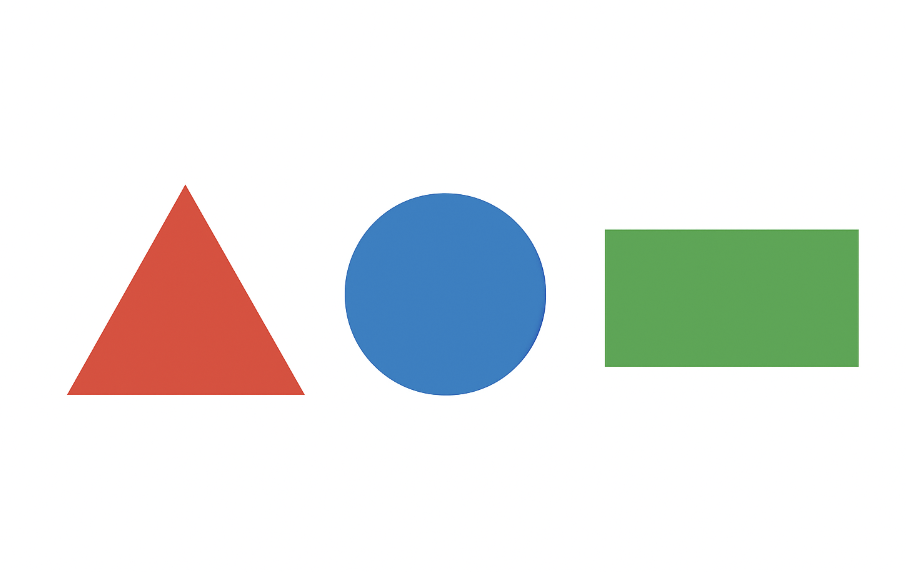

<div align="center">
    
</div>

## История

В оживлённом городе **Геометрия** молодому архитектору Адильхану поручено важное задание: проанализировать чертежи нового «**ПолиПарка**» — футуристического развлекательного комплекса, спроектированного исключительно из базовых геометрических фигур. Мэру города Дархану необходимо точно знать, сколько различных геометрических фигур (треугольников, прямоугольников, кругов и т.д.) содержится на каждом чертеже, чтобы рассчитать расход материалов, распределить строительные бригады и запланировать работу 3D-принтеров.

К сожалению, помощник Адильхана случайно сохранил все чертежи в виде RGB-изображений, а не векторных диаграмм или CAD-файлов. В результате автоматизированная программа подсчёта фигур сейчас на техническом обслуживании! До дедлайна осталось всего 5 часов, и Адильхан обращается за помощью к **вашей команде** — талантливым школьникам-решателям задач.

Каждое изображение чертежа содержит от **100 до 500** различных геометрических фигур. Фигуры могут отличаться по размеру, цвету и ориентации, но всегда чётко прорисованы сплошными контурами и не перекрываются или пересекаются неоднозначным образом (то есть каждая фигура легко отделима от других). Ваша миссия — написать программу (или разработать метод), которая по заданному RGB-изображению чертежа выводит **точное количество** геометрических фигур на нём.

## Формулировка задачи

Вам дано изображение в стандартном RGB-формате (например, PNG или JPG) размером $2048 \times 2048$ пикселей. На изображении присутствует $N$ геометрических фигур ($100 \leq N \leq 500$), каждая из которых относится к одному из следующих типов: треугольник, прямоугольник, или круг. Фигуры нарисованы сплошными цветными контурами (обводками) и могут иметь прозрачную или закрашенную внутреннюю область. Фон изображения чётко отличим от контуров фигур.

## Входные данные

Один RGB-файл изображения на каждый тестовый пример.

Изображение будет предоставлено в стандартном формате, поддерживаемом популярными библиотеками (например, OpenCV, PIL).

Фигуры не перекрываются таким образом, чтобы их контуры слились. Каждая фигура представляет собой одну связную компоненту при рассмотрении пикселей контура.

## Выходные данные

CSV файл (submit.csv), где в каждом ряде одно целое число — общее количество обнаруженных геометрических фигур на изображении.

**Важно:** Отправляйте только файл submit.csv. Исходный код не требуется. Порядок значений идентификаторов в файле submit.csv должен строго соответствовать порядку в файле test.csv, начиная с 0 и до максимального идентификатора.

## Оценка решения

Ваше решение будет протестировано на 8000 изображениях.

Метрика оценки — **Адаптированная точность**, определяемая по следующей формуле:

$$\text{Уровень ошибки} = \frac{ \left| \hat{y} - y \right| }{ y }$$

$$\text{Точность} = 1 - \min\left(1, \text{Уровень ошибки}\right)$$

$$\text{Итоговая оценка} = \begin{cases} 0, & \text{если } \text{Точность} > 0.55 \\ \frac{\text{Точность} - 0.55}{1 - 0.55}, & \text{в противном случае} \end{cases}$$

$$\textbf{Обозначения:} \quad \hat{y} = \text{предсказание модели}, \quad y = \text{реальное количество фигур (метка)}$$

## Пример

**Входное изображение:**


Пример: содержит 1 красный треугольник, 1 синий круг, 1 зелёный прямоугольник)

**Ваш результат:**  
 `3`

Данные — `train.csv`, `submit.csv`, а также папки с изображениями `train/` и `test/` — находятся в `data.zip` (см. раздел **Данные** ниже).

## Советы участникам

Вы можете использовать любой язык программирования и библиотеки (OpenCV, scikit-image, PIL и др.).

Рассмотрите методы обнаружения границ, поиска контуров и классификации фигур по таким признакам, как число углов, соотношение сторон или круглость.

Помните: вам нужно лишь **подсчитать** фигуры — не обязательно определять их тип (если только это не помогает вашему алгоритму подсчёта).

Протестируйте своё решение на разнообразных примерах: маленькие и большие фигуры, разные цвета, повёрнутые формы.

## Почему это важно

В реальных задачах компьютерного зрения подсчёт и обнаружение объектов на изображениях имеет огромное значение — от подсчёта клеток в медицинских снимках до детектирования транспортных средств на камерах дорожного наблюдения. Эта задача имитирует практическую инженерную проблему и одновременно развивает ваши навыки в области обработки изображений и машинного обучения.

Удачи!

С уважением,

— *Мэр города Геометрия, Дархан*

## Data

[Download data.zip (575 MB)](https://contest.faio.kz/problems/01a1c0a6-defd-708d-8de8-fbe0c4826867/public/data.zip)

```bash
wget https://contest.faio.kz/problems/01a1c0a6-defd-708d-8de8-fbe0c4826867/public/data.zip
```
